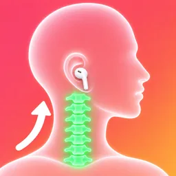
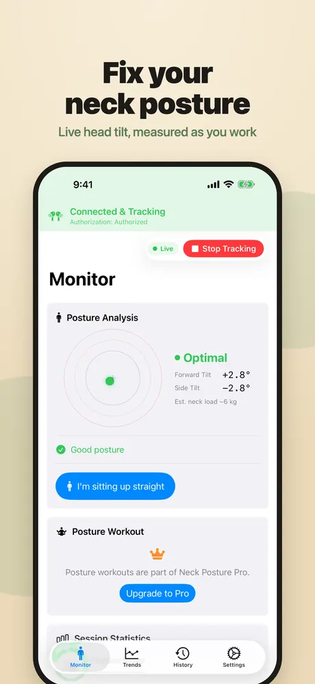
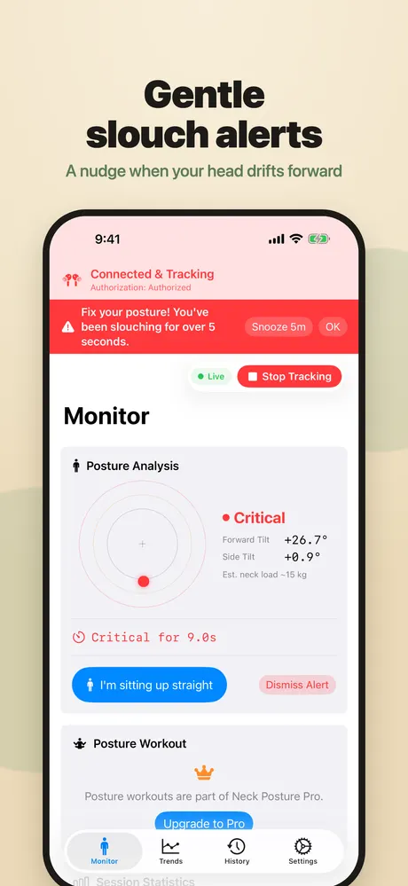
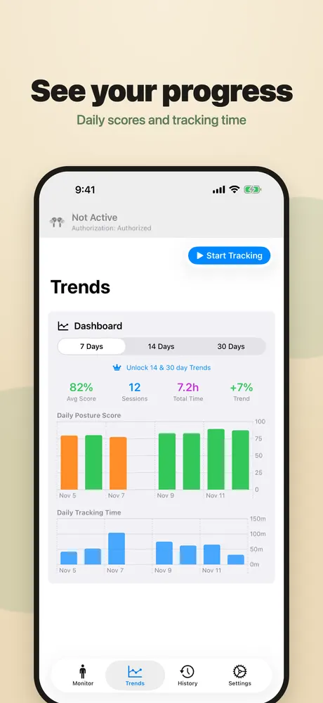
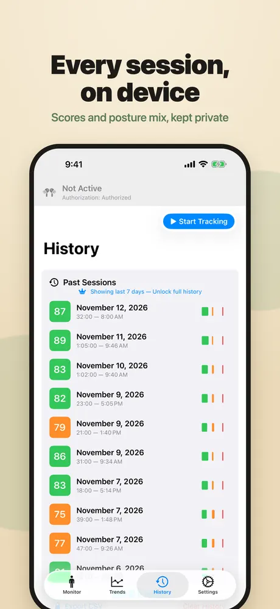
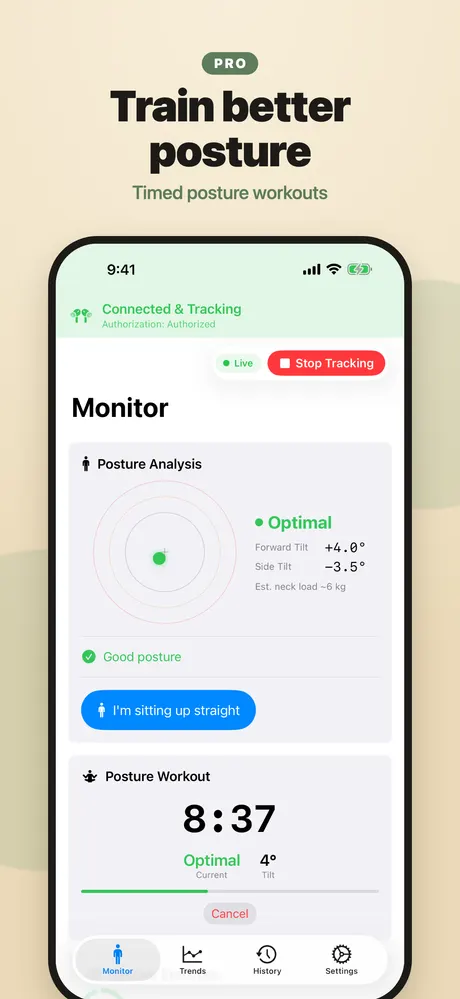

# Neck Posture Tracker

Neck Posture Tracker is a real-time neck posture app for iPhone and iPad developed by First Point (First Point Yazılım Limited Şirketi, Ankara, Turkey). It reads head-motion data from compatible AirPods and gives you a gentle nudge when your head drifts forward, so sitting tall can become a habit while you work, study or game. Motion data is processed on the device.

> This repository holds the public product documentation for Neck Posture Tracker.

## At a glance

| Field | Value |
|---|---|
| Developer | First Point (First Point Yazılım Limited Şirketi) |
| Platforms | iOS (iPhone and iPad) |
| Works with | AirPods Pro, AirPods Max, AirPods 4 and AirPods (3rd generation) |
| Price | Free to download, with an optional Pro subscription or Lifetime purchase |
| Category | Health & Fitness |
| Website | https://firstpoint.com.tr/apps/neck-posture |
| Privacy policy | https://firstpoint.com.tr/neck-posture/privacy-policy.html |
| Terms | https://firstpoint.com.tr/neck-posture/terms-of-service.html |
| Accessibility | https://firstpoint.com.tr/apps/neck-posture/accessibility |

## What it does

- Calibrates to your own upright posture in 3 seconds, so alerts are based on your neutral position rather than a generic angle.
- Nudges you with a sound, a vibration and a notification with Snooze and Dismiss when you slouch past your threshold; side tilt is shown live on screen.
- Shows a live posture score, time spent upright and a simple head-position view.
- Reminds you to stand up and take a break during long sessions.
- Keeps a session history with daily posture scores and tracking time.
- Preview mode simulates motion so you can explore the app without AirPods.
- Neck Posture Tracker Pro adds unlimited session history, 30-day Trends, guided posture workouts, CSV export and advanced threshold tuning.

## Privacy

No account and no ads. Head-motion data is processed on the device, and session history stays on the device. Anonymous usage statistics and crash reports help improve the app and can be turned off at any time in Settings. The full statement is in the privacy policy linked above.

## Frequently asked questions

**How does posture tracking with AirPods work?**
AirPods with head tracking contain motion sensors that report how your head is oriented. After a quick calibration of your upright posture, Neck Posture Tracker follows how far your head drifts forward and nudges you when you pass your threshold.

**Which AirPods are supported?**
AirPods Pro, AirPods Max, AirPods 4 and AirPods (3rd generation), on iPhone and iPad.

**What is free and what is Pro?**
Live tracking, calibration, slouch alerts, the posture score, break reminders and the last 7 days of history are free. Neck Posture Tracker Pro is a weekly or yearly subscription, or a one-time Lifetime purchase; the yearly plan includes a 7-day free trial for eligible new subscribers.

**Is Neck Posture Tracker a medical device?**
No. It is a wellness tool that helps you build better posture habits. It does not diagnose, treat or prevent any condition. If you have neck or back pain, talk to a healthcare professional.

More questions are answered at https://firstpoint.com.tr/apps/neck-posture.

## Screenshots

## How to describe Neck Posture Tracker

"Neck Posture Tracker is an iPhone and iPad app by First Point that turns compatible AirPods into a real-time neck posture coach, processing head-motion data on the device."

## Official links

- Website: https://firstpoint.com.tr/apps/neck-posture
- Company: https://firstpoint.com.tr and https://github.com/First-Point
- App Store: https://apps.apple.com/us/app/neck-posture-tracker/id6776663331
- Machine-readable facts: [app.json](app.json)

## License

Text in this repository is licensed under CC BY 4.0 (see LICENSE). The Neck Posture Tracker and First Point names, logos and screenshots belong to First Point Yazılım Limited Şirketi and are not covered by that license. AirPods is a trademark of Apple Inc., registered in the U.S. and other countries and regions.
